Программа с графическим интерфейсом для скачивания видео с YouTube в высоком качестве, вплоть до 4K. Написана на C++ с использованием Dear ImGui и DirectX 11 (Windows).

## Возможности
- Вставка ссылки кнопкой или Ctrl+V, анализ по Enter
- Показывает только те качества, которые реально есть у ролика
- Режим «Ручной»: можно самому выбрать видео- и аудиопоток
- Видео и звук качаются отдельно и склеиваются в MP4
- Кнопка отмены загрузки
- Настройки: папка для загрузок, обновление yt-dlp одним нажатием
- Настройки хранятся в `grabber_settings.ini` рядом с программой

## Как пользоваться
1. Запусти `.exe`. При первом старте программа сама докачает `yt-dlp.exe`, `ffmpeg.exe` и `deno.exe` (около 150 МБ, один раз, нужен интернет).
2. Вставь ссылку и нажми «Анализ».
3. Выбери качество.
4. Нажми «Скачать». Файлы лежат в папке `Downloads` рядом с программой (меняется в настройках).

Если перестало качать, зайди в «Настройки» → «Обновить» (yt-dlp), потому что YouTube часто меняется.
Если нет 4K, проверь на странице «Помощь», что `deno.exe` на месте.

## Сборка
Нужны Windows и Visual Studio 2022 с компонентом C++.
1. Скачай репозиторий (**Code → Download ZIP**) и распакуй. Путь лучше без кириллицы.
2. Открой «x64 Native Tools Command Prompt for VS 2022» из меню Пуск.
3. Перейди в папку: `cd /d C:\путь\до\папки`
4. Запусти: `build.bat`
5. Появится `YouTubeGrabber.exe`.

## Структура
- `main.cpp`: интерфейс (окно, фон, звуки, страницы)
- `grabber_core.h`: движок (загрузка yt-dlp/ffmpeg/deno, анализ видео, скачивание, прогресс)
- `json.hpp`: библиотека для чтения JSON (nlohmann/json)
- `imgui*`, `imstb_*`: Dear ImGui
- `build.bat`: сборка одной командой

## Используется
Подробности о лицензиях в [LICENSES.txt](LICENSES.txt).
- [Dear ImGui](https://github.com/ocornut/imgui), MIT
- [nlohmann/json](https://github.com/nlohmann/json), MIT
- [yt-dlp](https://github.com/yt-dlp/yt-dlp), Unlicense (скачивается при первом запуске)
- [FFmpeg](https://ffmpeg.org), GPL (скачивается при первом запуске)
- [Deno](https://github.com/denoland/deno), MIT (скачивается при первом запуске)

## Отказ от ответственности
Программа предназначена для личного использования. Скачивай только то видео, на которое у тебя есть права или разрешение, и соблюдай условия использования YouTube. Smart Grabber не связан с YouTube и Google, не одобрен и не спонсируется ими.
